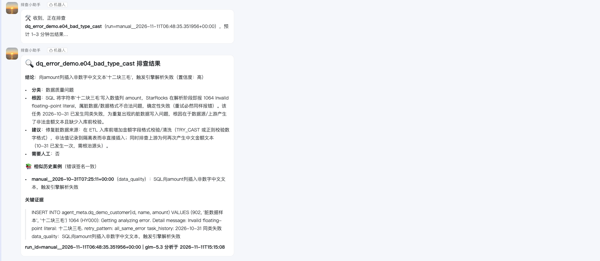

# DQ-Agent：数仓任务故障排查机器人

[](https://github.com/xiekunming/data-quality-agent/actions/workflows/ci.yml)


Airflow 调度的数仓（ETL）任务失败后，在钉钉群里 **@机器人 + 任务名**，它会自动读取失败日志、
用规则引擎压缩提取关键信息（SQL 正文 / Traceback / 重试签名），交由 LLM 分析根因——
必要时 LLM 会**自主调用只读 SQL 工具回查数据库核实**（如核对实际列定义、统计脏数据行数），
约 20-60 秒内在群里回一条结构化结论：**问题分类 / 根因 / 关键证据 / 处理建议 / 置信度**，
并自动带上"相似历史案例"（同一错误的历史结论）。

```
钉钉群 @机器人 任务名
   │  Stream 长连接（免公网 IP）
   ▼
bot.py 收发编排（候选/序号选择/超时转后台/防重复分析）
   ▼
orchestrator  解析任务 → 查缓存（命中秒回）→ 定位日志 → 规则提取快照
              （原始日志 210KB → 快照 ~20KB：SQL 去重/错误段截取/框架栈帧折叠/
                重试签名对比/脱敏，全程零 token）
   ▼
analyzer  快照 + 任务失败史 + 签名召回的历史案例 → LLM 分析
          └─ 可调只读工具回查库：sql_query / table_schema（三层防线）
   ▼
render  结论 → 群内 markdown（分类/根因/证据/建议/相似案例）
```

## 特性

- **规则提取 + LLM 判断的分层设计**：日志解析是确定性正则（免费/毫秒/可复现），根因推理交给模型
- **重试签名**：只对异常类行做哈希，识别"多次重试是否同一错误"（all_same_error=确定性错误，重试无意义），作为模型的重要判据
- **function calling 只读核查工具**：语句守卫（仅 SELECT 类单条）→ 行数截断 → 查询超时，三层防线；模型能自查列名、数脏数据
- **知识库与历史上下文**：同错误签名精确召回历史案例 + 任务失败史注入，模型可识别"反复出现的老毛病"；结论自动沉淀
- **热更新提示词**：错误分类法（`prompts/taxonomy.yaml`）与系统提示词改文件即生效，无需重启
- **工程容错**：StarRocks 主存储 + SQLite 自动降级；超时任务转后台完成后补推；缓存去重
- **回测有 ground truth**：内置错误注入 DAG（7 类已知根因的失败样本），分类准确率 7/7
- 28 个单元/集成测试

## 快速开始

```bash
git clone https://github.com/xiekunming/data-quality-agent.git && cd data-quality-agent
python3 -m venv .venv && .venv/bin/pip install -r requirements.txt
cp .env.example .env        # 填 GLM_API_KEY（https://open.bigmodel.cn）

# 30 秒体验：离线回放内置样例日志（不需要 Airflow/StarRocks/钉钉）
.venv/bin/python scripts/analyze_cli.py --sample          # SQL 语法错误样本
.venv/bin/python scripts/analyze_cli.py --sample e03_not_null_violation

# 看快照长什么样（不调 LLM，不花 token）
.venv/bin/python scripts/analyze_cli.py --sample --no-llm

# 接入真实环境（本机 Airflow 日志 + 钉钉机器人）
.venv/bin/python scripts/analyze_cli.py <dag_id> <task_id> --force   # 终端排查
.venv/bin/python -m dq_agent                                          # 前台启动机器人
# macOS 长期常驻（推荐）：launchd 服务化 = 开机自启+崩溃自愈，安装见 docs/operations.md §4.1
```

> 完整搭建（接入你自己的 Airflow / 钉钉群 / StarRocks，四档渐进）见 **[docs/setup.md](docs/setup.md)**。

## 机器人交互

### 群里的两个机器人

钉钉群里通常有**两个机器人各司其职**，本项目是第二个：

| 机器人 | 类型 | 职责 | 归属 |
|---|---|---|---|
| 告警机器人 | webhook 自定义机器人 | Airflow 任务失败时**播报**告警消息（生产原有链路） | 不属于本项目 |
| 排查机器人 | Stream 机器人（本项目） | 被 **@** 后读取日志、分析根因、回复结论 | 本项目 |

```
Airflow 任务失败 ──► 告警机器人播报 ──► 人看到后 @排查机器人 任务名 ──► 结论回到群里
（本项目建设告警链路零侵入：不改告警格式、不加依赖，纯增量接入）
```

告警机器人的播报行可直接**粘贴给排查机器人**（见下面方式 3），无需手敲任务名。

### @机器人的四种方式

在钉钉群里 **@机器人**，四种方式（@机器人 发“帮助”可随时查看）：

1. **精确指定**：`@机器人 dag=x | task=y | run=z`
2. **任务名**：`@机器人 etl_loan_report` —— 自动匹配；同名任务出现在多个 DAG 时会列出候选，回复**序号**选择
3. **粘贴告警行**：`@机器人 <DAG: demo_dag>-20261023-etl_loan_report Failed`
4. **光 @ 不带任务**：列出最近失败的任务列表，回复**序号**选择

说明：同一 run 的结论有缓存（再 @ 秒回）；排查中重复 @ 会提示等待；分析超时自动转后台、
完成后补推，不丢任务。机器人收不到“引用消息”的原文，引用告警时请带上任务名或直接粘贴告警行。

## 项目结构

```
.
├── dq_agent/                          # 核心包：故障排查全链路
│   ├── config.py                      # config.yaml + .env 加载
│   ├── models.py                      # TaskRef / LogSnapshot / AnalysisResult
│   ├── log_locator.py                 # dag/task/run -> attempt 日志文件（本地优先，REST 兜底）
│   ├── log_extractor.py               # 规则提取：元信息/SQL/错误段/签名/脱敏/截断
│   ├── store.py                       # StarRocks 主 + SQLite 降级；快照/结论/知识库/历史上下文 API
│   ├── llm.py                         # LLM 客户端（OpenAI 兼容；支持 tools 与思考档位模板）
│   ├── analyzer.py                    # 快照+上下文+提示词 -> GLM（工具循环）-> 结构化结论
│   ├── orchestrator.py                # 编排：@消息解析、缓存、预采集、上下文组装、知识沉淀
│   ├── taxonomy.py                    # 分类法加载器（taxonomy.yaml 热更新）
│   ├── tools.py                       # 只读核查工具（sql_query/table_schema，三层防线）
│   ├── alert_server.py                # 本地预采集 HTTP 服务（可选）
│   └── dingtalk/                      # 钉钉收发与渲染
│       ├── bot.py                     # 钉钉 Stream 机器人（收发编排/候选序号/去重/超时后台）
│       └── render.py                  # 群内结论渲染
├── prompts/                           # 提示词（热更新）
│   ├── analyze_log.md                 # 系统提示词
│   └── taxonomy.yaml                  # 错误分类法
├── samples/                           # 样本与离线回放
│   ├── dq_error_demo_dag.py           # 错误注入 DAG：7 类已知根因失败样本
│   └── logs/                          # 脱敏样例日志（--sample 数据源）
├── scripts/                           # 工具脚本
│   ├── analyze_cli.py                 # 终端排查（--sample 离线回放 / --no-llm 免费看快照）
│   ├── backtest.py                    # 历史失败批量回测
│   ├── run_bot.sh / start_bot.sh      # 机器人启动（launchd 入口 / 手动兜底）
│   ├── com.dq-agent.plist.template    # macOS launchd 服务模板
│   └── dq-agent.service               # Linux systemd 服务模板
├── tests/                             # 28 个 pytest 用例（含离线集成用例）
├── docs/                              # 文档
│   ├── setup.md                       # 安装搭建指南（四档渐进）
│   └── operations.md                  # 运维手册（架构/改动查找表/排障/部署）
├── CHANGELOG.md                       # 版本历史（与 git tag 对应）
└── README.md                          # 项目主页说明
```

## 生产部署

本项目可在企业生产环境使用：共性难点已在代码与模板层解决（systemd/launchd 服务模板、
换模型/网关全配置化、StarRocks/MySQL/SQLite 三档存储、查库只读三层防线、
Airflow REST 日志兜底通道）。**前提一条**：日志快照含业务 SQL 与数据片段，
LLM 必须用内网/可托管模型（数据出域合规是一票否决项）。与本地的主要差异是三点——
**失败日志的获取通道**、**LLM/钉钉的网络出口**、**数据库只读账号**，属部署选型而非代码改动；
参考架构（两条候选路线：REST 零侵入拉取 / callback 域内采集落表）与上线清单见
[docs/operations.md §4](docs/operations.md)。

## 配置

模型与连接全部走 `config.yaml`（通用默认值）+ `.env`（真实值，见 `.env.example`）。
换自部署模型/网关：改 `llm.base_url`/`model` + `llm.thinking`（思考档位 JSON 模板，
按网关文档填，留空不发）即可，代码零改动。

## 效果示例

钉钉群里 @机器人 后收到的排查结论（脏数据写入数值列案例：LLM 调只读工具核对实际数据与
错误签名后，给出结论/根因/建议，并自动召回同签名的历史失败）：



另一次 SQL 列名拼写错误类失败（离线回放，LLM 调工具核对实际表结构后）：

> **结论**：SQL 中误写列名 `custstat`，实际列为 `cust_status`，1064 列无法解析（置信度：高）
> - **分类**：代码/Schema 问题
> - **根因**：核查该表实际列定义：存在 `cust_status`（varchar(16)），不存在 `custstat` 列；同 SQL 其他分支均正确使用带下划线写法，属笔误。3 次重试签名完全一致（all_same_error），重试不可能成功。
> - **数据核查**：已执行 2 次只读库查询核实

## Roadmap

**已完成**：核心排查链路 / 工具化查库（三层防线）/ 分类法热更新 / 提速（68s→20.7s）/
历史上下文 + 签名召回知识库 / 错误注入回测（7/7）/ 服务化模板（launchd+systemd）/
离线回放样例（--sample，零依赖体验）

**规划中**：多轮追问 / 上游任务状态工具 / run 智能选择 / 周报统计 /
回归评测（改 prompts/换模型自动重跑回测集，防劣化）/ 存活心跳（定时报平安）/
审计日志（@请求方与工具 SQL 留痕）/
半自动修复（人工审批，需写权限，暂缓）

## License

[MIT](./LICENSE) © [xiekunming](https://github.com/xiekunming)

## 作者

**xiekunming**（GitHub 主页见仓库 owner）

## 开发说明

本项目开发过程使用 AI 辅助编程工具（代码生成与重构）；架构设计、技术决策与取舍、
全部代码的理解与验证由作者独立完成。
